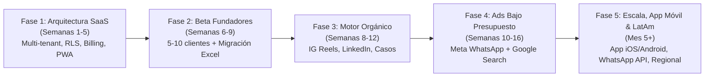
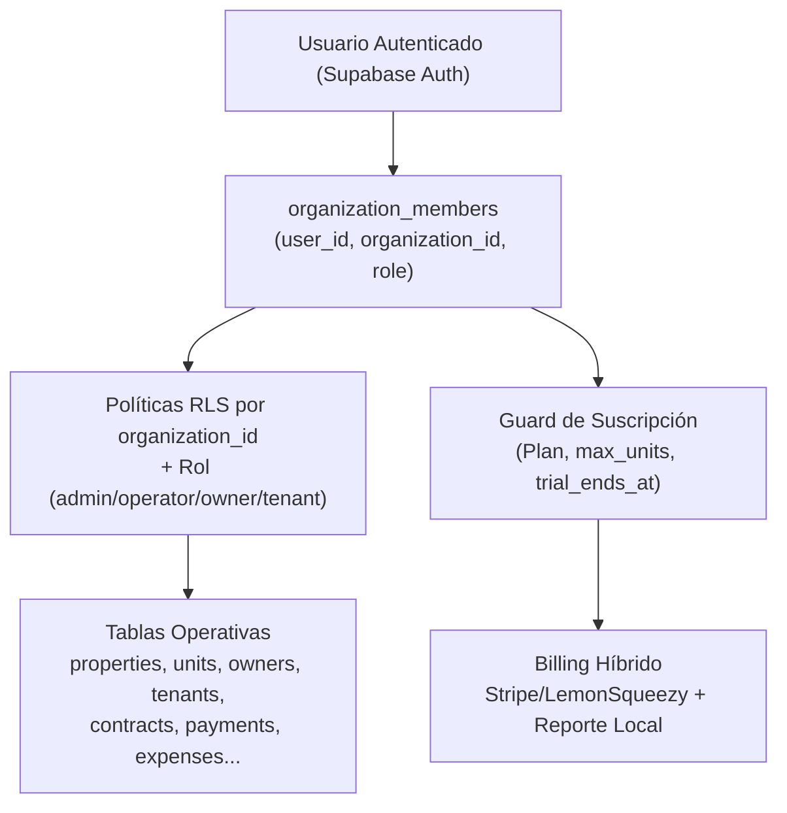

# Plan Maestro de Escalamiento a SaaS

> [!NOTE]
> Este plan fue diseñado a partir del análisis directo de la arquitectura actual del repositorio (`Next.js 16 + Supabase + Resend + DolarAPI`), sus fortalezas competitivas (doble moneda USD/Bs, tasa BCV automática, conciliación PagoMóvil/Zelle, recibos personalizados y **3 portales: Admin, Propietario e Inquilino**) y las brechas técnicas críticas que deben resolverse antes de incorporar múltiples clientes.

---

## 1. Naming e Identidad de Marca

### ¿Por qué cambiar "SIAA" (y desvincularlo de "Escritorio Legal")?
- **SIAA** suena a siglas gubernamentales o software de escritorio antiguo; no comunica modernidad, facilidad ni valor financiero.
- En el código actual ([frontend/app/layout.tsx](frontend/app/layout.tsx), [database_migrations/schema.sql](database_migrations/schema.sql) y [README.md](README.md)), la marca está mezclada con **"Escritorio Legal"**, lo cual limita la percepción comercial si le vendes a inmobiliarias, administradoras o dueños independientes.
- Un buen nombre SaaS debe ser **corto (2–3 sílabas)**, fácil de pronunciar por teléfono/WhatsApp, escalable de Venezuela a toda Latinoamérica y transmitir **orden, control financiero y profesionalismo**.

### Propuestas de Nombres por Territorio de Marca

| Territorio | Opciones | Qué transmite | Ideal si tu enfoque es... |
| :--- | :--- | :--- | :--- |
| **PropTech Moderno (Estilo Alegra / Stripe)** | **Rentaria**, **Arendia**, **Rentix**, **Domera** | Tecnología moderna, confianza, escalabilidad regional | Posicionarte como el SaaS líder de alquileres en LatAm |
| **Resonancia Local / Patrimonial** | **CanonHQ**, **MiCanon**, **Predia**, **Patrimonia** | En Venezuela/LatAm el alquiler se llama *"canon de arrendamiento"* — conexión inmediata | Administradoras formales, escritorios jurídicos y dueños de edificios |
| **Directo y Claro (Ideal para Ads fríos)** | **InmoFlow**, **RentFlow**, **AlquilaPro**, **CobraRenta** | Se entiende en 1 segundo qué hace el software | Conversión rápida en anuncios de Meta/Google sin explicar la marca |
| **Cercano y Memorizable** | **Llaveo**, **HabitaPay**, **KasaControl**, **NidoPro** | Accesible, menos frío, amigable para inquilinos y propietarios | Propietarios independientes + pequeñas administradoras |

### Top 3 Recomendado

1. **Rentaria** *(Recomendación #1 — Balance perfecto)*: Suena tan sólido y amigable como marcas SaaS latinas exitosas (Alegra, Siigo, Holded). Funciona igual de bien para una inmobiliaria grande en Caracas, Bogotá o Panamá que para un propietario con 10 locales. Tagline sugerido: *"Rentaria — Tus alquileres, cobros y propietarios en orden."*
2. **Arendia** *(Recomendación #2 — Más corporativo/premium)*: Derivado de *arrendamiento*, elegante, distintivo y con menos saturación de palabras genéricas como "rent" en buscadores y dominios.
3. **MiCanon / CanonFlow** *(Recomendación #3 — Diferenciación cultural)*: Habla exactamente el idioma legal e inmobiliario de Venezuela y gran parte de Hispanoamérica. Genera curiosidad instantánea en el nicho correcto.

> [!TIP]
> **Checklist antes de decidir el nombre definitivo (toma 20 minutos):**
> 1. Disponibilidad de dominio `.com` o `.app` (ej. `rentaria.app` / `getrentaria.com`).
> 2. Disponibilidad de handle consistente en Instagram, TikTok y LinkedIn (`@rentaria.app` o `@usarentaria`).
> 3. Búsqueda rápida en Google y registro de marcas (SAPI en Venezuela / TMview) para evitar conflictos con inmobiliarias ya existentes.
> 4. **Prueba de WhatsApp**: dilo en voz alta en una nota de voz; si la otra persona tiene que preguntar "¿cómo se escribe?", descártalo.

---

## 2. Estrategia de Conversión a SaaS

### Tu Ventaja Competitiva Injusta (Moat)
Los software globales de PropTech (Buildium, AppFolio, DoorLoop, Rentec) no están diseñados para la realidad venezolana/latinoamericana: cobran en tarjetas estadounidenses (\$60–\$280+/mes), no manejan **doble moneda USD/Bs con tasa BCV diaria**, no entienden **PagoMóvil/Zelle**, no dividen ingresos por **porcentaje entre copropietarios/beneficiarios** y suelen estar en inglés.

Tu software **ya tiene construidas** las piezas más difíciles de copiar para este mercado:
- Conciliación de pagos reportados por el inquilino con comprobante + aprobación en 1 clic.
- Doble moneda automática (USD/Bs) con tasa BCV integrada.
- **Triple portal** (Administrador + Propietario + Inquilino): convierte a cualquier administradora pequeña en una empresa con tecnología de nivel corporativo frente a sus clientes.
- Recibos imprimibles con logo del propietario y estados de cuenta exportables a PDF/Excel.

### Público Objetivo (ICP — Ideal Customer Profile)

| Segmento | Perfil | Tamaño de cartera | Dolor principal | Prioridad |
| :--- | :--- | :--- | :--- | :--- |
| **A. Administradoras e Inmobiliarias** | Empresas o equipos que administran propiedades de terceros | 15 – 300+ unidades | Conciliación manual eterna (Excel + WhatsApp + BCV) y propietarios pidiendo estados de cuenta | **#1 (Core SaaS — mayor LTV)** |
| **B. Escritorios Jurídicos** | Abogados inmobiliarios que llevan contratos y cobranza de familias/inversionistas | 10 – 150 unidades | Imagen profesional, control de contratos vencidos, reparto a copropietarios | **#2 (Muy rentable y ya validado)** |
| **C. Propietarios Patrimoniales** | Familias o inversionistas con edificios, locales o galpones propios | 5 – 30 unidades | Desorden en cobros, morosidad oculta, recibos hechos a mano | **#3 (Volumen rápido y venta corta)** |

### Modelo de Precios (Value-Based Pricing por Unidades Activas)
Cobrar por **cantidad de unidades activas** (apartamentos, locales, oficinas, galpones) es el estándar ganador en PropTech porque **tu ingreso crece automáticamente cuando tu cliente crece**.

| Plan | Límite de Unidades | Precio Mensual | Precio Anual (-20%) | Incluye |
| :--- | :--- | :--- | :--- | :--- |
| **Starter** *(Propietarios)* | Hasta 15 unidades | **\$29 / mes** | \$23 / mes (\$276/año) | 1 Admin, Portal Inquilinos, cobros USD/Bs + BCV, recibos PDF, reportes básicos |
| **Pro** *(Administradoras — Más popular)* | Hasta 60 unidades | **\$69 / mes** | \$55 / mes (\$660/año) | Hasta 3 operadores, **Portal Propietarios**, logo propio, gastos/ingresos, estados de cuenta por correo, mantenimiento |
| **Business** *(Inmobiliarias)* | Hasta 200 unidades | **\$149 / mes** | \$119 / mes (\$1.428/año) | Operadores ilimitados, copropietarios avanzados, importación asistida, soporte prioritario WhatsApp, sin marca en recibos |
| **Enterprise** | 200+ unidades | **Desde \$249 / mes** | A medida | Subdominio/dominio propio (*white-label*), integraciones a medida, SLA dedicado |

> [!IMPORTANT]
> **Dos reglas clave de monetización para este mercado:**
> 1. **No lances un plan Free para siempre.** En B2B vertical el freemium atrae usuarios que consumen soporte sin pagar. Ofrece **14 días de prueba gratis sin tarjeta** + un **Plan Fundadores** (primeros 15 clientes con **40%–50% de descuento vitalicio** + migración de su Excel gratis a cambio de feedback y testimonio).
> 2. **Cobranza Híbrida obligatoria:** Combina pasarela internacional recurrente (**Stripe / LemonSqueezy / Paddle**) con cobro local asistido (**Zelle, PagoMóvil, Binance USDT, Zinli**). En Venezuela perderás más del 60% de las ventas si solo aceptas tarjeta internacional.

### Efecto Viral Integrado (Product-Led Growth)
En los planes Starter y Pro, incluye un pie de página discreto en recibos PDF, correos y portales: *"Gestionado con [TuMarca]"* con enlace a tu landing. Cada inquilino (que muchas veces también es dueño de otro inmueble) y cada propietario se convierte en un canal de adquisición gratuito.

---

## 3. Hoja de Ruta Detallada: Paso a Paso

---

### Fase 1: Transformación Técnica a SaaS Multi-Tenant (Semanas 1–5)

El código actual es **single-tenant** (pensado para una sola empresa). Antes de subir al segundo cliente, debes ejecutar estos 5 bloques técnicos en orden estricto:

#### 1.1 Refactor de Base de Datos a Multi-Tenant ([database_migrations/schema.sql](database_migrations/schema.sql))
- **Evolucionar `companies` -> `organizations`**: Agregar `slug` (único), `plan_tier`, `subscription_status` (`trialing`, `active`, `past_due`, `cancelled`), `trial_ends_at`, `max_units`, `default_currency`, `country_code` (preparado para expandir a CO, PA, MX, DO más adelante) y `email_settings`.
- **Crear tabla `organization_members`**: `(id, organization_id, user_id, role, status, invited_by, created_at)`. Permite que un usuario pertenezca a una organización de forma explícita y que en el futuro un mismo propietario o inquilino acceda a 2 administradoras con el mismo correo.
- **Agregar `organization_id UUID NOT NULL REFERENCES public.organizations(id)`** a todas las tablas operativas: `owners`, `owner_beneficiaries`, `owner_bank_accounts`, `properties`, `property_owners`, `units`, `tenants`, `tenant_contacts`, `contracts`, `payments`, `expenses`, `maintenance_requests`, `notifications`, `notification_templates`, `owner_expenses`, `owner_incomes` e `interactions`.
- **Corregir índices y restricciones `UNIQUE` globales**: Hoy `owners.doc_id`, `tenants.doc_id` y `contracts.contract_number` son únicos en toda la base de datos. En un SaaS, dos administradoras pueden tener el mismo inquilino o el contrato `001`. Cambiarlos a `UNIQUE (organization_id, doc_id)` y `UNIQUE (organization_id, contract_number)`, además de indexar `organization_id` en todas las tablas.

#### 1.2 Blindaje de Seguridad (Bloqueante Crítico)
> [!CAUTION]
> **Brecha actual detectada en el repositorio:**
> 1. Casi todas las tablas en [database_migrations/schema.sql](database_migrations/schema.sql) tienen políticas `USING (auth.role() = 'authenticated')` (y `interactions` no tiene RLS). En un SaaS esto permitiría que un cliente lea o borre datos de otro cliente.
> 2. Server Actions como [frontend/actions/access.ts](frontend/actions/access.ts) y [frontend/actions/company.ts](frontend/actions/company.ts) usan `supabaseAdmin` (service role) sin verificar en el servidor la sesión ni a qué organización pertenece el solicitante.

**Acciones obligatorias:**
1. Crear funciones SQL `SECURITY DEFINER`: `current_user_org_ids()` y `has_org_role(org_id, roles[])`.
2. Reescribir todas las políticas RLS para validar `organization_id` **y** el rol exacto (ej. un `tenant` solo puede leer sus propios `contracts`, `payments` y `maintenance_requests`, e insertar pagos en estado `pending` solo para sus contratos; un `owner` solo ve propiedades donde aparece en `property_owners`).
3. Implementar un guard de servidor (`requireOrgAccess(allowedRoles)`) al inicio de **todos** los Server Actions (`frontend/actions/*`) y API Routes (`frontend/app/api/*`).
4. **Aislar Storage**: Guardar archivos bajo prefijo `{organization_id}/...`. Convertir los buckets de contratos PDF, comprobantes de pago y recibos de gastos a **buckets privados** servidos con URLs firmadas (`createSignedUrl`), dejando públicos únicamente los logos.
5. Activar validación de sesión en middleware/proxy de Next.js además de los layouts cliente.

#### 1.3 Onboarding, Rebranding y Correos Multi-Tenant
- **Landing Page real en `/` ([frontend/app/page.tsx](frontend/app/page.tsx))**: Mover el login a `/signin` y construir en `/` una página comercial enfocada en conversión (propuesta de valor, demo visual de los 3 portales, tabla de precios, FAQ y botones a "Probar 14 días gratis" + "Hablar por WhatsApp").
- **Wizard de Onboarding (Registro -> Valor en <5 minutos)**:
  - Paso 1: Datos de la empresa/propietario y logo.
  - Paso 2: Botón **"Cargar datos de ejemplo"** (para probar el sistema al instante sin llenar formularios) o **"Crear mi primera propiedad"**.
  - Paso 3: **Importador de Excel/CSV** (Propiedades, Unidades, Inquilinos y Contratos). *Esta sola función elimina la principal excusa de compra de las administradoras.*
- **Rebranding dinámico**: Eliminar "Escritorio Legal" y "SIAA" de [frontend/app/layout.tsx](frontend/app/layout.tsx), [frontend/lib/email-templates.ts](frontend/lib/email-templates.ts) y [frontend/lib/payment-pdf-generator.tsx](frontend/lib/payment-pdf-generator.tsx). En [frontend/lib/mail.ts](frontend/lib/mail.ts), enviar correos con remitente `"${org.name} vía [TuMarca] <notificaciones@tumarca.com>"` y `replyTo: org.email`.

#### 1.4 Facturación, Límites y Panel Super-Admin
- Tablas `plans`, `subscriptions` y `subscription_payments`.
- **Enforcement suave de límites**: Validar `max_units` y `max_operators` en servidor antes de crear registros nuevos, mostrando modal claro de upgrade. Si una suscripción vence, dar **5–7 días de gracia** y luego pasar la cuenta a modo *solo lectura* (nunca borrar datos ni bloquear el acceso de consulta abruptamente).
- **Cobranza local integrada**: Pantalla en `/billing` donde el cliente puede pagar con tarjeta (Stripe/LemonSqueezy) **o** reportar su pago por Zelle/PagoMóvil/USDT con comprobante.
- **Panel `/superadmin`**: Ver todas las organizaciones, estado de trials, MRR, uso de unidades, botón para aprobar pagos manuales o extender pruebas, y auditoría básica.

#### 1.5 Mejoras de Producto con ROI Inmediato para Ventas
1. **Botón "Enviar por WhatsApp" (Costo \$0 en MVP)**: Al aprobar un pago, generar un estado de cuenta o detectar morosidad, incluir un botón que abre `wa.me` con el mensaje redactado profesionalmente (monto, tasa BCV, período, enlace al portal/recibo). Luego en Fase 5 se automatiza con WhatsApp Cloud API.
2. **Calidad y Observabilidad**:
   - Escribir un script de pruebas automatizadas de aislamiento multi-tenant (verificar que Usuario de Org A recibe 0 filas al consultar tablas de Org B y que un Tenant no puede aprobar su propio pago).
   - Conectar **Sentry** (errores en producción) y **PostHog** (ver en qué paso abandonan el onboarding).
   - Limpiar gradualmente los errores críticos de ESLint en los archivos que se modifiquen.

#### 1.6 Plan de App Móvil (Estrategia Progresiva: PWA -> App Nativa iOS/Android)
Una app móvil es un **diferenciador comercial enorme** en este sector (especialmente para propietarios e inquilinos), pero construirla desde el día 1 retrasaría la salida al mercado y duplicaría mantenimiento. La estrategia recomendada se divide en **2 etapas**:

- **Etapa A — PWA Instalable (Corto plazo, dentro de Fase 1–2):**
  - Configurar `manifest.json`, íconos, splash screen y experiencia *mobile-first* pulida en los portales de **Inquilino** y **Propietario**.
  - Permitir agregar la app a la pantalla de inicio del teléfono sin pasar por App Store / Google Play.
  - Acceso directo a cámara/galería del teléfono para subir comprobantes de PagoMóvil/Zelle y fotos de solicitudes de mantenimiento.
  - *Ventaja:* Validas el uso móvil real con costo \$0 y sin frenar las primeras ventas.

- **Etapa B — App Móvil Nativa Multiplataforma (Mediano plazo, Fase 5 — al superar ~20–30 clientes pagos):**
  - **Stack recomendado:** **React Native con Expo** (comparte TypeScript, validaciones Zod y lógica de negocio con el frontend actual y se conecta directo al mismo backend de **Supabase** respetando Auth y políticas RLS multi-tenant). *Alternativa rápida si se prioriza velocidad sobre experiencia 100% nativa: Capacitor.*
  - **Alcance priorizado por rol (no replicar todo el panel admin complejo):**
    1. **Inquilinos (Prioridad #1):** Reportar pago en 2 toques (subir capture o foto), **notificaciones Push** de recordatorio de vencimiento y confirmación de pago aprobado, descarga/envío de recibo PDF y reportes de mantenimiento con foto desde cámara.
    2. **Propietarios (Prioridad #1):** Dashboard móvil en tiempo real, **notificaciones Push** cuando se aprueba un pago de sus propiedades, vista rápida de morosidad y descarga de estados de cuenta.
    3. **Administradores/Operadores (Modo rápido en campo):** Aprobar/rechazar pagos pendientes desde notificación Push, consultar ficha de inquilino/contrato y registrar gastos fotografiando facturas. *(Configuraciones avanzadas y reportes masivos se mantienen en la web).*
  - **Impacto comercial y monetización:**
    - Las **notificaciones Push nativas** aumentan la tasa de pago puntual (se leen mucho más que el correo).
    - Se posiciona como ventaja competitiva incluida en planes **Pro / Business**, y con opción de **app white-label (marca propia en tiendas)** como upsell de alto valor para clientes **Enterprise**.
  - **Requisitos operativos a prever:** Cuentas de desarrollador (Apple Developer \$99/año + Google Play \$25 pago único), Expo Push Notifications / Firebase Cloud Messaging (FCM) y manejo de enlaces profundos (*deep links*) hacia recibos y pagos.

---

### Fase 2: Validación y "Cohorte Fundadores" (Semanas 6–9)

Antes de gastar dinero en anuncios, valida el producto SaaS con **5 a 10 clientes reales pagando**:

1. **Oferta irresistible ("Programa Fundadores")**:
   - 50% de descuento congelado por 12 meses (o vitalicio).
   - **Migración Llave en Mano Gratis**: tú les cargas su Excel de propiedades, inquilinos y contratos en 48 horas.
   - A cambio: 1 llamada de 15 min al mes para feedback y permiso para usar su testimonio/caso de éxito.
2. **Dónde conseguir esos primeros 10 clientes sin gastar en Ads**:
   - Red directa del cliente actual ("Escritorio Legal") — pide 3 referidos a colegas abogados o clientes propietarios.
   - Búsqueda manual en Instagram y Google Maps de inmobiliarias/administradoras medianas en tu ciudad (lista de 50 prospectos).
   - Grupos locales de corredores inmobiliarios, cámaras inmobiliarias regionales y contadores que llevan condominios/alquileres.
3. **Meta de esta fase**: Lograr al menos 5 cuentas activas cobrando su segundo mes consecutivo, identificar las 3 fricciones más repetidas en el onboarding y documentar 2–3 métricas reales (ej. *"redujeron de 3 días a 2 horas el cierre mensual"*).

---

### Fase 3: Estrategia de Redes Sociales (Orgánico B2B)

No intentes estar en todas las redes. Concéntrate en **2 canales principales + 1 de reciclaje + WhatsApp como cierre**:

| Canal | Rol en el embudo | Frecuencia sostenible (1–2 personas) | Formato ganador |
| :--- | :--- | :--- | :--- |
| **Instagram** | Descubrimiento y confianza local (Venezuela/LatAm) | 3 Reels + 1 Carrusel/semana + Historias 4–5 días | Reels cortos (30–45s) con demos reales + carruseles de dolor |
| **LinkedIn** *(Perfil personal del fundador)* | Venta B2B a dueños de inmobiliarias, gerentes y expansión LatAm | 2–3 posts/semana | Casos reales, lecciones de gestión, capturas del producto ("Build in Public") |
| **TikTok / YouTube Shorts** | Alcance orgánico gratuito | Reciclaje directo de los 3 Reels de IG | Mismo video sin marca de agua |
| **WhatsApp Business** | Conversión y seguimiento | Diario | Catálogo de planes, respuestas rápidas, Estados con novedades y testimonios |

#### Los 4 Pilares de Contenido (Regla 40 / 30 / 20 / 10)
1. **40% Dolor y Agitación (Hooks que detienen el scroll)**:
   - *"Si hoy te tocó buscar en 40 chats de WhatsApp quién te pagó por PagoMóvil y a qué tasa BCV... mira esto."*
   - *"La razón silenciosa por la que los propietarios cambian de administradora (y no es la comisión)."*
   - *"Excel sirve para 3 apartamentos. Con 15 ya te está costando dinero y errores."*
2. **30% Micro-Demos ("Muestra, no cuentes")**:
   - Videos de 30 segundos grabando la pantalla real (con zoom en las acciones clave):
     - Demo 1: Inquilino sube comprobante -> Admin aprueba en 1 clic -> Recibo PDF listo con logo del propietario.
     - Demo 2: Cálculo automático a tasa BCV del día sin abrir la calculadora.
     - Demo 3: Así ve el propietario sus ingresos, gastos y morosos en tiempo real desde su teléfono.
3. **20% Educación Práctica del Nicho**:
   - Cómo estructurar estados de cuenta claros para propietarios con múltiples copropietarios.
   - Checklist para renovar contratos y evitar morosidad crónica.
   - Regala una **plantilla de Excel gratuita** (Lead Magnet) para capturar leads -> y luego les muestras por qué tu SaaS automatiza esa misma plantilla.
4. **10% Prueba Social y Transparencia**:
   - Testimonios cortos, métricas agregadas (*"Ya se conciliaron +X pagos este mes"*), nuevas funciones sugeridas por clientes.

---

### Fase 4: Estrategia de Ads con Bajo Presupuesto (\$150 – \$300/mes)

Con un presupuesto acotado (**\$5 a \$10 diarios**), cada dólar debe ir a **generar conversaciones calificadas o pruebas gratuitas**.

> [!WARNING]
> **Errores que queman presupuesto bajo (evítalos):**
> - Nunca uses el botón azul **"Promocionar publicación"** en Instagram. Usa siempre **Meta Ads Manager**.
> - No pagues campañas de "Reconocimiento de marca" ni "Tráfico" puro; optimizan para curiosos que no compran.
> - No segmentes con 20 intereses hiper-restringidos: deja que el **texto y el video filtren al comprador** (ej. empezar el video diciendo *"¿Administras propiedades de alquiler?"*).

#### Distribución Recomendada del Presupuesto

| Canal | % del Presupuesto | Inversión sugerida (en \$200/mes) | Objetivo de Campaña | Público |
| :--- | :---: | :--- | :--- | :--- |
| **Meta Ads (IG + FB) — Prospección** | **65%** | \$130/mes (~\$4,3/día) | **Mensajes a WhatsApp** o **Clientes Potenciales (Formulario)** | **Conjunto 1:** Intereses (Bienes raíces, Inmobiliaria, Administración de propiedades, Inversiones inmobiliarias) en ciudades de alto poder adquisitivo (Caracas, Valencia, Lechería, Maracaibo, Barquisimeto, Margarita). **Conjunto 2:** Público amplio (28–60 años, mismas ciudades) dejando que el creativo filtre. |
| **Google Search Ads** | **25%** | \$50/mes (~\$1,7/día) | **Conversiones / Leads** (Alta intención) | Búsquedas exactas/de frase: `"software administracion alquileres"`, `"sistema para inmobiliarias"`, `"control de pagos de alquiler"`, `"programa gestion de propiedades"`. Negativizar: *gratis, descargar crack, excel gratis, curso, empleo*. |
| **Meta Ads — Retargeting** | **10%** | \$20/mes (~\$0,7/día) | **Mensajes / Registro Trial** | Personas que visitaron tu landing, vieron >50% de tus videos o interactuaron en IG en los últimos 30 días. |

#### 3 Creativos Obligatorios para Probar desde el Día 1
1. **Creativo A — Video directo al dolor (30s, estilo nativo/UGC)**: Tú hablando a cámara en vertical, sin sobreproducción: *"¿Administras más de 5 inmuebles en alquiler y todavía cuadras pagos de Zelle, PagoMóvil y tasa BCV en Excel? Mira cómo automatizamos todo..."* + 15s de pantalla real + CTA *"Escríbenos 'DEMO' por WhatsApp y te mostramos con tus propios números"*.
2. **Creativo B — Imagen estática de contraste ("Antes vs. Después")**: Izquierda caótica (chats de WhatsApp, capturas sin nombre, hoja de cálculo con errores, calculadora BCV); Derecha limpia (captura de tu Dashboard + Recibo PDF impecable). Headline: *"Deja de perseguir comprobantes. Profesionaliza tus alquileres desde \$29/mes."*
3. **Creativo C — Ángulo "Diferénciate ante tus propietarios"**: Enfocado al **Portal de Propietarios**. Headline: *"Imagina darle a cada propietario su propio portal con el logo de tu administradora."*

#### Métricas de Control (Semáforo de Decisiones)
- **Costo por conversación en WhatsApp (CPL)**: Meta saludable **\$1,50 – \$4,50**. Si tras 4–5 días (> \$15 gastados) un creativo supera \$6 sin leads calificados, apágalo y prueba un nuevo hook.
- **Tasa de conversación -> Demo agendada**: Objetivo **20% – 30%**.
- **Tasa de Demo -> Cliente pago**: Objetivo **15% – 25%**.
- **Matemática de viabilidad**: Con \$200/mes -> ~65 leads -> ~16 demos -> **3 a 4 nuevos clientes/mes** (ticket promedio \$69 = \$207–\$276 MRR nuevo). Recuperas el costo de adquisición (CAC) en el **mes 1–2**, y como el cliente se queda 12+ meses, la máquina se autofinancia rápidamente.

---

### Fase 5: Playbook de Ventas y Escenarios para Captar al Público Objetivo

#### El Flujo de Venta Consultiva en 4 Pasos (Ticket \$29–\$150/mes)
1. **Calificación por WhatsApp en 3 mensajes (menos de 2 minutos)**:
   - *"¡Hola [Nombre]! Gracias por escribir. Para mostrarte justo lo que te sirve sin quitarte tiempo: 1) ¿Cuántas unidades/propiedades administras hoy? 2) ¿Son propias o de terceros? 3) ¿Qué te da más dolor de cabeza hoy: cobrar/conciliar, la tasa BCV o pasarle reportes a los dueños?"*
2. **Demo Quirúrgica de 15 Minutos (Zoom / Google Meet / Presencial)**:
   - **Prohibido** hacer un recorrido aburrido módulo por módulo.
   - Dedica 3 minutos a confirmar su proceso actual y calcular cuánto tiempo pierde al mes.
   - Dedica 10 minutos a mostrar **solo los 3 flujos que resuelven su dolor exacto** (casi siempre: conciliación BCV + recibo automático + portal propietario/inquilino).
   - Dedica 2 minutos al cierre.
3. **Cierre sin Fricción (Elimina el miedo a cambiar)**:
   - *"Te propongo algo simple: activamos hoy tus 14 días gratis. Si me pasas tu Excel de propiedades e inquilinos, mi equipo te carga las primeras 20 unidades sin costo esta misma semana para que lo pruebes con datos reales."*
4. **Cadencia de Seguimiento (El 70% de las ventas B2B ocurren entre el seguimiento #2 y #5)**:
   - **Día +1**: Enviar resumen de 3 líneas + link al video corto de la función que más le gustó.
   - **Día +3**: Enviar ejemplo real de un recibo PDF o estado de cuenta con el nombre/logo de la empresa del prospecto *(impacto brutal)*.
   - **Día +7**: Compartir caso breve de otro cliente similar.
   - **Día +14**: Cierre de cortesía (*"¿Prefieres que retomemos esto el próximo mes antes del cierre de cobros o lo dejamos en pausa?"*).

---

#### Cómo Abordar los 5 Escenarios Clave del Mercado

| Escenario | Quién es | Gancho de Atención | Ángulo Ganador en la Demo |
| :--- | :--- | :--- | :--- |
| **1. Administradora saturada en Excel + WhatsApp** | 20–100 unidades, 1–3 personas ahogadas del 1 al 10 de cada mes | *"¿Cuántas horas te toma hoy cuadrar pagos mixtos (Zelle + PagoMóvil + BCV) y mandar recibos?"* | Mostrar el flujo **Inquilino reporta -> 1 clic aprueba -> Recibo + Estado de cuenta actualizado**. Venderles **horas de vida recuperadas** y capacidad de duplicar cartera sin contratar personal. |
| **2. Propietario patrimonial poco tecnológico** | Dueño de 1 edificio o 10 locales, 45–65 años, desconfiado de "sistemas complicados" | *"Saber en 10 segundos quién te pagó, quién te debe y cuánto entró este mes, desde tu celular."* | Cero jerga técnica. Mostrar solo el **Dashboard simple**, la lista de morosos en rojo y el **recibo en PDF listo para enviar por WhatsApp**. Ofrecer carga inicial incluida. |
| **3. Inmobiliaria o Escritorio Jurídico que quiere diferenciarse** | Compite por captar propietarios exigentes; cobra 8%–10% de comisión | *"¿Cómo justificas tu comisión de administración cuando el dueño siente que solo 'cobras un alquiler'?"* | El arma secreta es el **Portal de Propietarios con su logo** + estados de cuenta profesionales por correo. No vendes un gasto, vendes **una herramienta para captar y retener más propietarios**. |
| **4. Prospecto que ya usa otro sistema o software contable** | Usa Profit/Saint/Alegra o un software genérico que no está hecho para alquileres | *"Tu software contable lleva la contabilidad, pero no persigue morosos, ni calcula contratos, ni le da portal a inquilinos."* | Posicionarte como el **complemento operativo especializado** (exportación directa a Excel para su contador) o reemplazo 3x más económico y adaptado a Venezuela. |
| **5. Prospección en frío (DM Instagram / LinkedIn / Puerta Fría)** | Administradoras locales que aún no te conocen | *Nunca mandar un muro de texto vendiendo.* Usar el método **"Video Loom / Captura personalizada de 45s"**. | Ejemplo de DM: *"Hola [Nombre], vi que administran alquileres en [Ciudad]. Grabé un video de 45 segs mostrando cómo podrían darle a sus propietarios un portal con el logo de [Su Empresa] y automatizar cobros a tasa BCV. ¿Te lo paso por aquí sin compromiso?"* |

---

#### Guión Rápido para las 6 Objeciones Más Comunes

1. ***"Está muy caro / ahora no tengo presupuesto"***
   > *"Entiendo. Si administras 30 unidades, el plan Pro son \$2,30 por unidad al mes — menos de un café por inmueble. Si el sistema te evita olvidar un solo ajuste, detectar un moroso a tiempo o te ahorra 15 horas al mes, se paga solo la primera semana."*
2. ***"Ya nos manejamos bien con Excel"***
   > *"Excel es buenísimo para empezar. La pregunta es: ¿tus inquilinos pueden descargar sus recibos solos en Excel? ¿Tus propietarios ven su estado de cuenta en tiempo real sin llamarte? Excel guarda datos; [TuMarca] trabaja por ti."*
3. ***"Mis inquilinos (o dueños mayores) no van a usar un portal web"***
   > *"No tienen que hacerlo si no quieren. Tú o tu operador pueden registrar el pago en 15 segundos y mandarles el recibo PDF directo por WhatsApp. Los que sí son digitales usan el portal y te quitan el 70% de la carga."*
4. ***"No tengo tiempo para migrar toda mi data"***
   > *"Es el miedo más normal. Por eso nosotros te hacemos la carga inicial desde tu Excel actual como parte de la activación. En 48 horas entras y ya ves tus edificios e inquilinos cargados."*
5. ***"¿Y si dejo de pagar o cancelo? ¿Pierdo mis datos?"***
   > *"Nunca. Tus datos son 100% tuyos: puedes exportar todos tus reportes, inquilinos y estados de cuenta a Excel/PDF cuando quieras, sin penalidades ni contratos forzosos."*
6. ***"No tengo tarjeta internacional para suscripciones"***
   > *"Cero problema, aceptamos PagoMóvil a tasa BCV, Zelle y Binance USDT, además de tarjeta internacional si prefieres cobro automático."*

---

## 4. Primeros Pasos Inmediatos (Próximos 7 Días)

- [ ] **Decisión #1 (Nombre y Dominio):** Elegir entre las propuestas de marca y registrar dominio + handles en IG/LinkedIn/TikTok.
- [ ] **Decisión #2 (Alcance del MVP SaaS):** Confirmar si lanzamos primero en **Venezuela (USD/Bs + PagoMóvil/Zelle)** y luego abrimos **Colombia/Panamá/LatAm** (haciendo moneda/tasa configurable por organización desde la Fase 1).
- [ ] **Decisión #3 (Arranque Técnico):** Comenzar el sprint de Fase 1 por el **diseño del nuevo `schema.sql` multi-tenant + políticas RLS estrictas + guard de Server Actions**.
- [ ] **Acción Comercial Paralela:** Armar desde hoy una lista de 30–50 administradoras/inmobiliarias/escritorios jurídicos para invitarlos al **Programa Fundadores** apenas el entorno multi-tenant esté desplegado.
